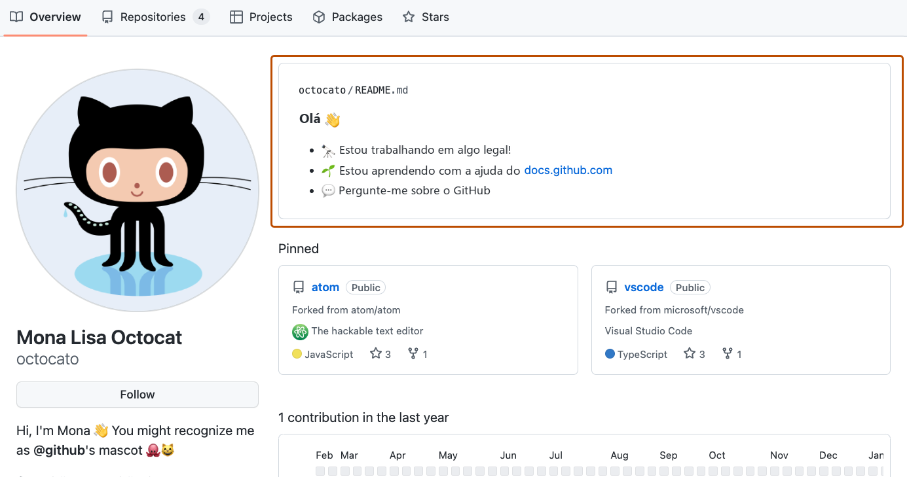
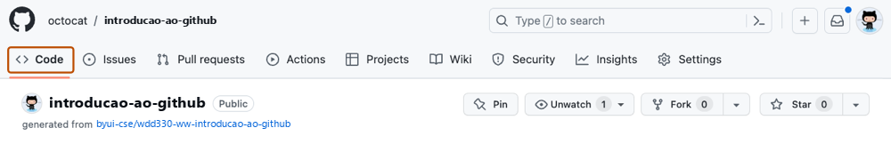
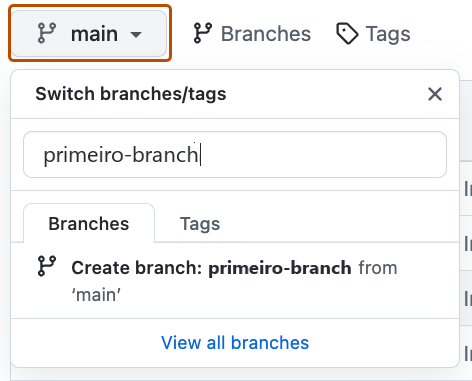
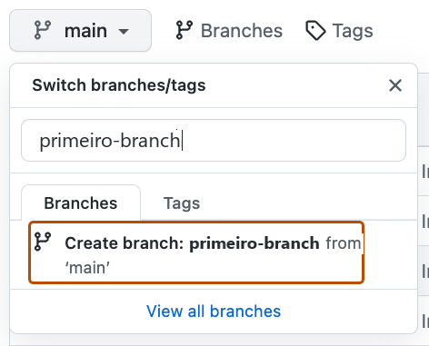

## Passo 1: Criar um Branch

_Boas-vindas ao exercício "Introdução ao GitHub"! :wave:_

**O que é o GitHub?** O GitHub é uma plataforma de colaboração que usa o _[Git](https://docs.github.com/pt/get-started/learning-about-github/github-glossary#git)_ para controlar as versões dos arquivos.
O GitHub é um lugar muito usado para compartilhar software de [código aberto](https://docs.github.com/pt/get-started/learning-about-github/github-glossary#open-source) e contribuir com ele.

:tv: [Vídeo: What is GitHub? ("O que é o GitHub?")](https://www.youtube.com/watch?v=pBy1zgt0XPc) &ndash; GitHub (em inglês)

**O que é um repositório?** Um _[repositório](https://docs.github.com/pt/get-started/learning-about-github/github-glossary#repository)_ é um projeto que contém arquivos e pastas.
O repositório guarda o histórico de versões desses arquivos e pastas. Para saber mais, consulte
"[Sobre repositórios](https://docs.github.com/pt/repositories/creating-and-managing-repositories/about-repositories)" na documentação do GitHub.

**O que é um branch?** Um _[branch](https://docs.github.com/pt/get-started/learning-about-github/github-glossary#branch)_ ("ramificação") é uma versão paralela do seu repositório.
Por padrão, o repositório tem um branch chamado `main` ("principal"), que é considerado a versão oficial do projeto.
Criar outros branches permite copiar o branch `main` do repositório e fazer alterações com segurança, sem atrapalhar o projeto principal.
Muitas pessoas usam branches para trabalhar em recursos específicos sem afetar as outras partes do projeto.

Os branches permitem separar o seu trabalho do branch `main`.
Ou seja, o trabalho de todos fica seguro enquanto você contribui.
Para saber mais, consulte "[Sobre branches](https://docs.github.com/pt/pull-requests/reference/branches)".

**O que é um README de perfil?** Um _[README de perfil](https://docs.github.com/pt/account-and-profile/how-tos/profile-customization/managing-your-profile-readme)_
é basicamente uma seção "Sobre mim" no seu perfil do GitHub, onde você pode compartilhar informações sobre você com a comunidade do GitHub.com.
O GitHub mostra o README do seu perfil no topo da sua página de perfil. Para saber mais, consulte "[Gerenciar o README do seu perfil](https://docs.github.com/pt/account-and-profile/how-tos/profile-customization/managing-your-profile-readme)".

### :keyboard: Atividade: Seu Primeiro Branch

1. Abra uma nova aba do navegador e vá até o repositório que você acabou de criar (a sua cópia deste exercício). Faça os passos na segunda aba enquanto lê as instruções nesta aba.

2. Clique na aba **< > Code** (Código) no menu do topo do seu repositório.

   

3. Clique no menu suspenso do branch **main**.

   

4. Na caixa de texto **Find or create a branch...** (Encontrar ou criar um branch...), digite `primeiro-branch`.

   > **Observação:** esse nome é verificado para você seguir para o próximo passo. :wink:

5. Clique no texto **Create branch: `primeiro-branch` from 'main'** (Criar branch `primeiro-branch` a partir do `main`) para criar o seu branch.

   

   - O GitHub muda automaticamente para o branch que você acabou de criar.
   - O menu suspenso que mostrava **main** agora mostra o nome do seu novo branch.

6. Agora que o seu branch está no GitHub, a Mona já deve estar conferindo o seu trabalho. Espere um momento e acompanhe os comentários. Ela vai responder com o seu progresso e a próxima lição.

Está com dificuldades? 🤷
 

Se você não receber uma resposta, confira:
- Se você criou o branch com o nome exato `primeiro-branch`, sem nada antes nem depois.

