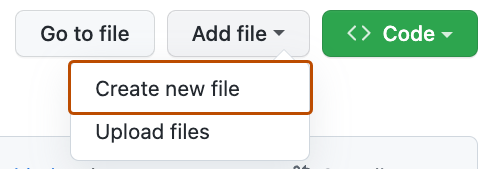
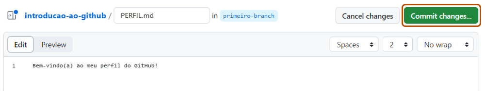
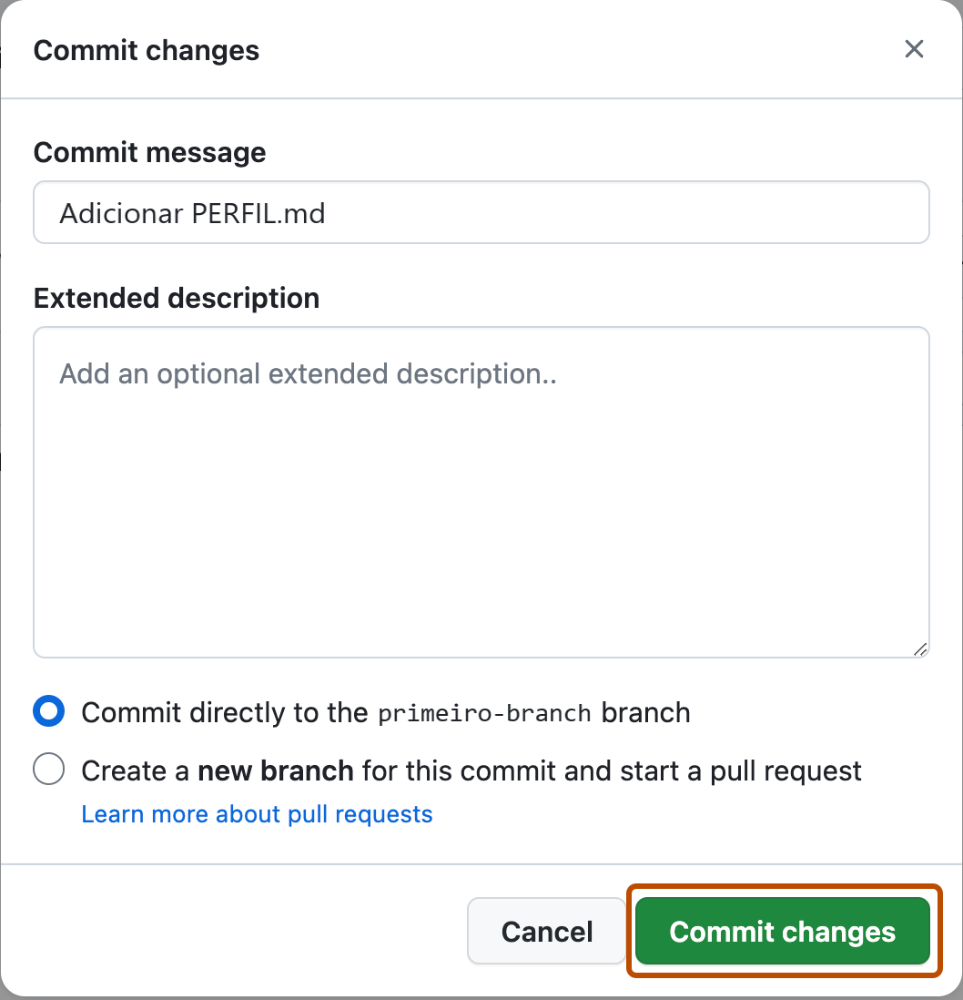

## Passo 2: Fazer o Commit de um Arquivo

_Você criou um branch! :tada:_

Criar um branch permite editar o seu projeto sem alterar o branch `main`. Agora que você tem um branch, é hora de criar um arquivo e fazer o seu primeiro commit!

**O que é um commit?** Um _[commit](https://docs.github.com/pt/pull-requests/reference/commits)_ é um conjunto de alterações nos arquivos e pastas do seu projeto. Todo commit fica em um branch. Para saber mais, consulte "[Sobre commits](https://docs.github.com/pt/pull-requests/reference/commits)".

### :keyboard: Atividade: Seu Primeiro Commit

Os passos a seguir mostram como fazer o commit de uma alteração no GitHub. Um commit registra alterações no projeto, como adicionar, remover ou renomear arquivos e modificar o conteúdo deles. Neste exercício, a alteração será adicionar um novo arquivo ao seu novo branch.

> [!NOTE]
> `.md` é a extensão de um arquivo Markdown ("linguagem simples para formatar texto"). Para saber mais sobre Markdown, consulte "[Sintaxe básica de escrita e formatação](https://docs.github.com/pt/get-started/writing-on-github/getting-started-with-writing-and-formatting-on-github/basic-writing-and-formatting-syntax)" na documentação do GitHub ou faça o exercício "[Communicate using Markdown](https://github.com/skills/communicate-using-markdown)" ("Comunicar-se usando Markdown", em inglês) do GitHub Skills.

1. Na aba **< > Code** (Código) do menu do topo do seu repositório, confira se você está no seu novo branch, `primeiro-branch`.

2. Abra o menu suspenso **Add file** (Adicionar arquivo) e clique em **Create new file** (Criar novo arquivo).

   

3. No campo **Name your file...** (Dê um nome ao arquivo...), digite `PERFIL.md`.

4. Na área **Enter file contents here** (Digite o conteúdo do arquivo aqui), copie o seguinte conteúdo para o seu arquivo:

   ```
   Bem-vindo(a) ao meu perfil do GitHub!
   ```

   

5. Clique em **Commit changes...** (Fazer commit das alterações...), no canto superior direito, acima da área de conteúdo. Uma janela vai abrir.

6. O GitHub sugere uma mensagem de commit, mas vamos escrever a nossa para praticar. Digite `Adicionar PERFIL.md` no campo **Commit message** (Mensagem do commit).

   - A **mensagem do commit** e a **descrição detalhada** opcional (**Extended description**) ajudam a explicar as suas alterações. Isso é muito útil quando o commit envolve vários arquivos.

   

7. Nesta lição, vamos ignorar os outros campos por enquanto. Clique em **Commit changes** (Fazer commit das alterações).

8. Agora que você alterou um arquivo, a Mona já deve estar conferindo o seu trabalho. Espere um momento e acompanhe os comentários. Ela vai responder com o seu progresso e a próxima lição.


<details>
<summary>Está com dificuldades? 🤷</summary><br/>

Se você não receber uma resposta, confira:
- Se você está no branch `primeiro-branch`.
- Se o arquivo `PERFIL.md` foi criado na pasta raiz ("a pasta principal do repositório, fora de qualquer outra pasta").

</details>
