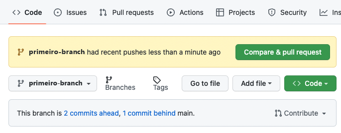
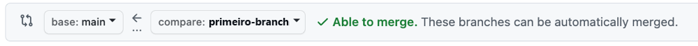
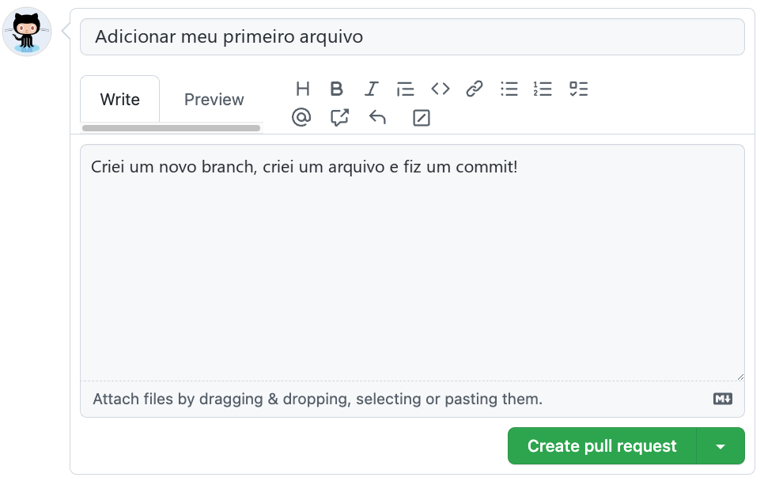

## Passo 3: Abrir um Pull Request

_Ótimo trabalho com esse commit! :sparkles:_

Agora que você fez uma alteração no projeto e criou um commit, é hora de compartilhar a alteração que você propõe por meio de um pull request (solicitação de mesclagem)!

**O que é um pull request?** A colaboração acontece em um _[pull request](https://docs.github.com/pt/get-started/learning-about-github/github-glossary#pull-request)_. O pull request mostra as alterações do seu branch para outras pessoas e permite que elas aceitem, rejeitem ou sugiram outras alterações no seu branch. Em uma comparação lado a lado, este pull request vai mostrar as alterações que você acabou de fazer no seu branch e propor que elas sejam aplicadas ao branch principal do projeto, o `main`. Para saber mais sobre pull requests, consulte "[Sobre pull requests](https://docs.github.com/pt/pull-requests/reference/pull-requests)".

### :keyboard: Atividade: Criar um Pull Request

Depois do seu commit, talvez você tenha visto uma mensagem avisando sobre o envio (push) recente para o seu branch, com um botão **Compare & pull request** (Comparar e criar pull request).

Para criar o pull request automaticamente, clique no botão **Compare & pull request** e pule para o item 5 abaixo. Se preferir, pratique criando o pull request manualmente, seguindo os 4 primeiros itens.

1. No menu do topo do seu repositório, clique na aba **Pull requests**.
2. Clique no botão **New pull request** (Novo pull request).
3. Selecione os seguintes branches nos menus suspensos:

   - **base:** `main` (branch que vai receber as alterações)
   - **compare:** `primeiro-branch` (branch com as suas alterações)

   

4. Clique em **Create pull request** (Criar pull request).

5. Digite um título para o seu pull request. Por padrão, o título é a sua mensagem de commit. Neste exercício, altere o campo para `Adicionar meu primeiro arquivo`.

6. O próximo campo serve para você escrever uma **descrição** das alterações que fez. Escreva uma descrição curta do que você fez até agora. Para lembrar: você criou um novo branch, criou um arquivo e fez um commit.

   

7. Clique em **Create pull request** (Criar pull request).

8. Agora que você abriu um espaço para colaborar, a Mona já deve estar conferindo o seu trabalho. Espere um momento e acompanhe os comentários. Ela vai responder com o seu progresso e a próxima lição.

Está com dificuldades? 🤷
 

Se você não receber uma resposta, confira:
- Se o título do seu pull request é `Adicionar meu primeiro arquivo`.
- Se o seu pull request tem uma descrição.

Para corrigir o título, abra o seu pull request, clique em **Edit** (Editar) ao lado do título, altere o texto e clique em **Save** (Salvar). Para corrigir a descrição, clique em **...** no canto do primeiro comentário do pull request e depois em **Edit** (Editar). A Mona confere de novo automaticamente.

