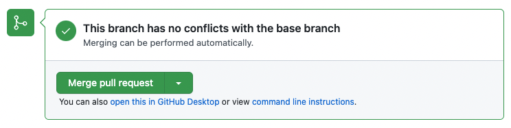
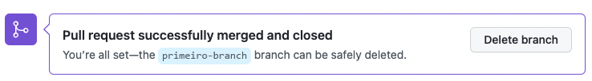

## Passo 4: Fazer o Merge do Seu Pull Request

_Muito bem! :sunglasses:_

Você criou um pull request (solicitação de mesclagem). Agora é hora de fazer o merge dele!

**O que é um merge?** Um _[merge](https://docs.github.com/pt/get-started/learning-about-github/github-glossary#merge)_ ("mesclagem") junta as alterações do seu pull request e do seu branch ao branch `main`. Para saber mais sobre merges, consulte "[Mesclar um pull request](https://docs.github.com/pt/pull-requests/how-tos/merge-and-close-pull-requests/merging-a-pull-request)".

### :keyboard: Atividade: Fazer o Merge do Pull Request

1. Clique em **Merge pull request** (Fazer merge do pull request).

   > **Observação:** talvez você veja workflows ("fluxos de trabalho automáticos") rodando no seu novo pull request, o que deixa o botão de merge desativado. Espere um momento até eles terminarem e o botão vai ser ativado.

2. Clique em **Confirm merge** (Confirmar merge).

   > **Dica:** Percebeu que essa janela é parecida com a de adicionar um arquivo? Um merge também é um tipo de commit!

3. Depois que o merge do seu branch for feito, você não precisa mais dele. Para excluir o branch, clique em **Delete branch** (Excluir branch).

   

4. Agora que o merge do seu trabalho foi feito, a Mona vai confirmar e mostrar uma revisão final. Bom trabalho! 🎉

Está com dificuldades? 🤷
 

Se você não receber uma resposta, confira:
- Se você concluiu as lições anteriores. Se elas não foram aprovadas, o botão de merge fica cinza.

